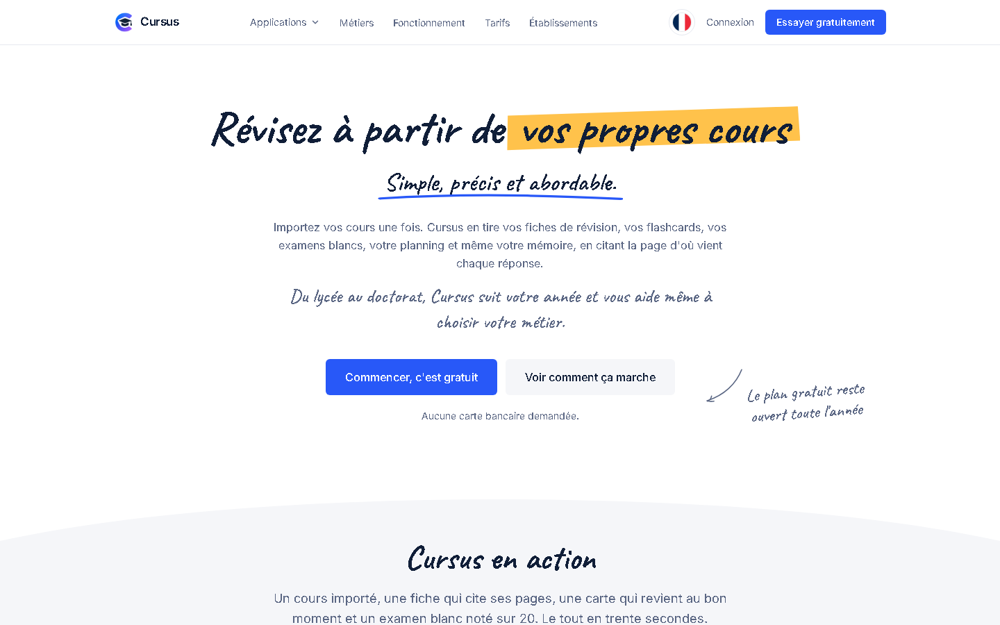
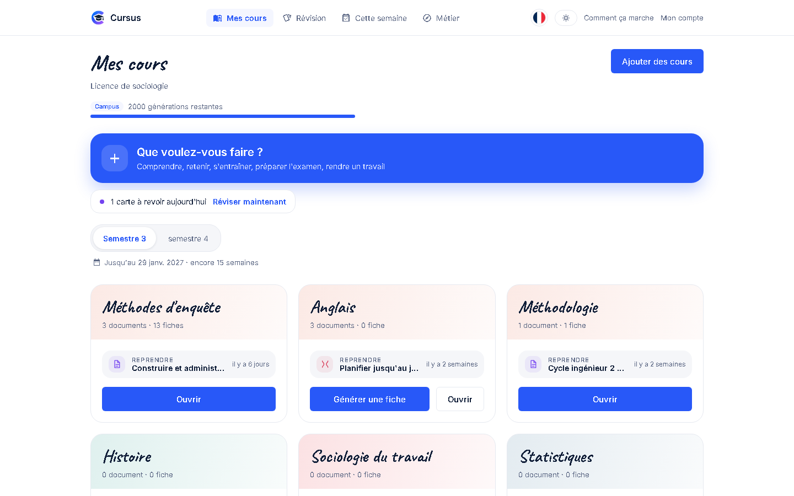
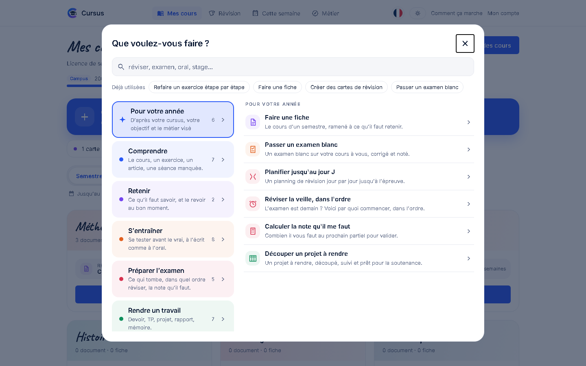
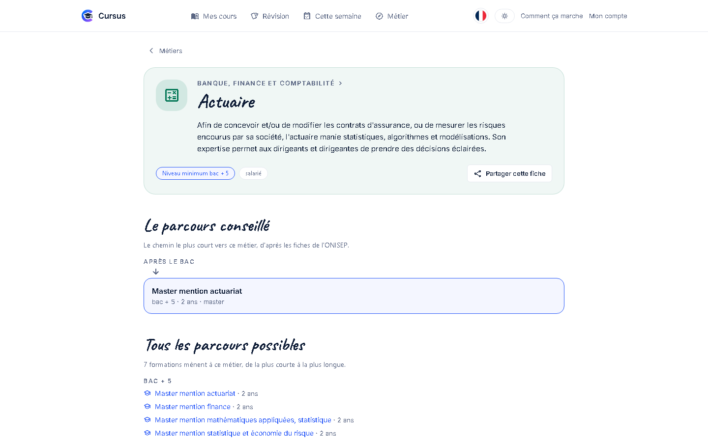
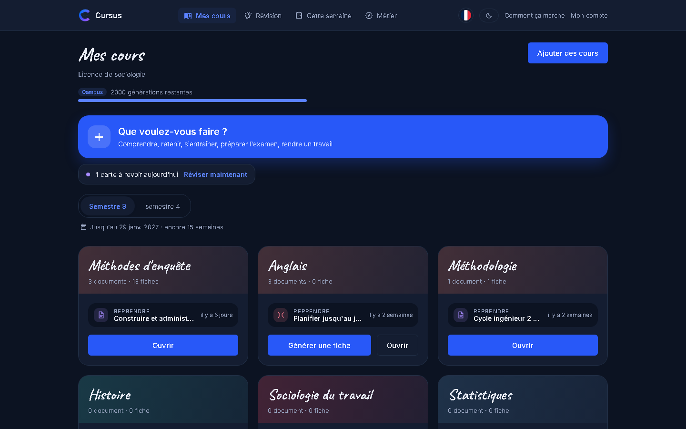
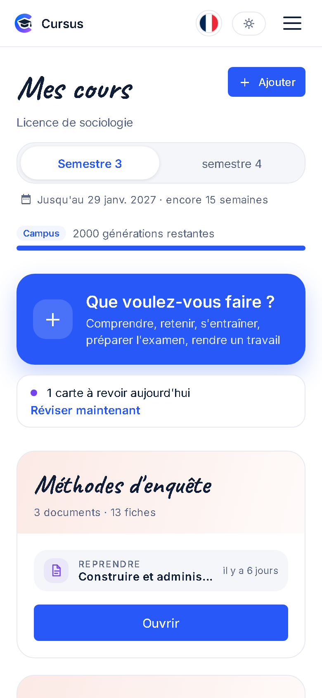

# Cursus

**Revise from your own courses.**

A student imports their courses once. Cursus turns them into revision sheets,
flashcards, mock exams and a revision plan, and every answer cites the page of
the course it comes from.

https://github.com/user-attachments/assets/cca2687b-b502-4c67-a9d9-3cdec40d0367

Thirty seconds of the product: a course dropped in, a sheet that cites its
pages, a card that comes back just before it is forgotten, and a mock exam
marked out of twenty. The home page plays it in each of its seven languages.

## The product

A course is fed once, from a handout, a photo of the board or a recording of
the lecture. Thirty-six applications read it, and the blue button asks what the
student came to do: understand, remember, practise, prepare the exam, hand in
work or organise the year. Every answer cites the passage it came from, and
nothing that comes out carries a watermark.

|                                                                                                                     |                                                                       |
| ------------------------------------------------------------------------------------------------------------------- | --------------------------------------------------------------------- |
|                                                                     |                                         |
| Over a thousand jobs from ONISEP's open data, the recommended path to each one and every training that leads there. | Light or dark, following the device until the student says otherwise. |

## What it costs

The free plan stays open all year, without a card: study sheets, flashcards and
three more applications, three generations a week and up to five more a day for
a short video, and every other application to try a few times a day. The
Student plan opens twenty-four applications with no wait, the Pro plan
thirty-five. The last one, CampusAI, comes with a school's Campus, through
which a school also gives its students a plan.

## Languages

The site, the app and the Campus speak French, English, Spanish, Portuguese,
German, Italian, and Arabic laid out right to left.

The roadmap is on the
[organisation board](https://github.com/orgs/CursusFR/projects/6), ordered by
what serves students first.
